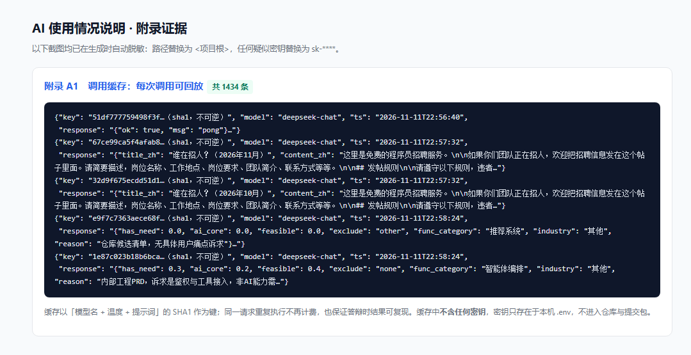
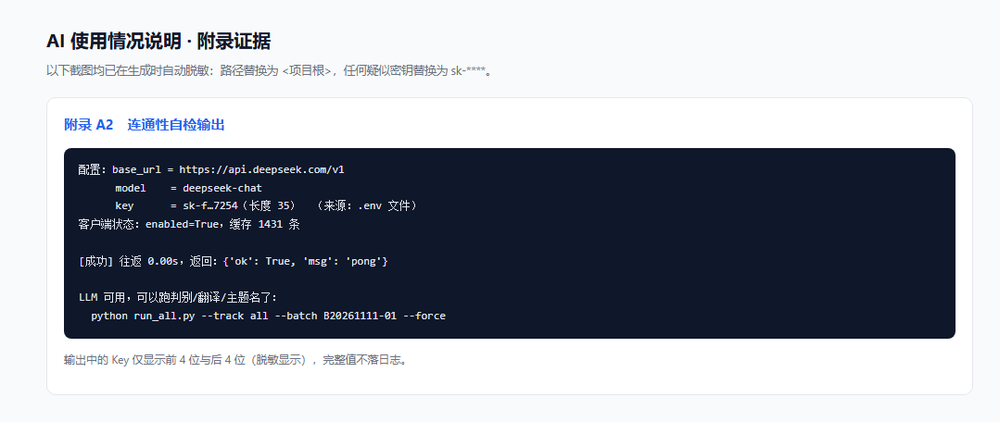
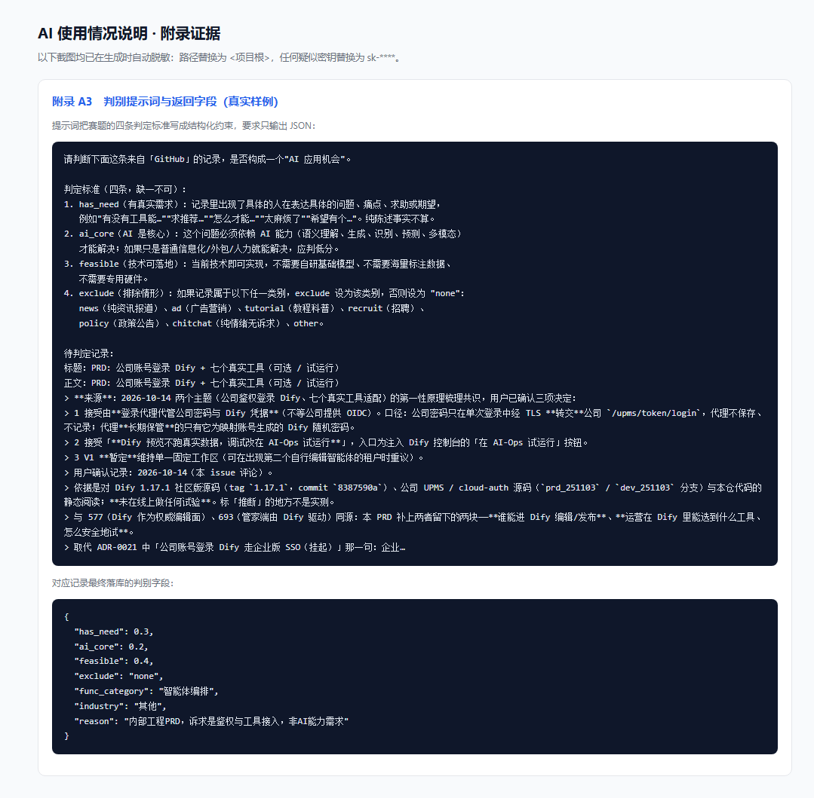

# AI 使用情况说明

《AI 应用场景的智能挖掘与机会评估系统》

编制日期：2026 年 11 月 15 日

> 说明：本文件按赛题要求编制，遵循「使用透明、留痕、可核验」原则。文中列出的 AI 工具名称与版本、使用目的、交互记录、采纳与人工修改情况均如实填写。

## 一、所用 AI 工具清单

| 工具 / 服务 | 版本或标识 | 提供方 | 接入方式 | 在本项目中的用途 |
|---|---|---|---|---|
| DeepSeek 大模型 API | deepseek-chat（2026-11 调用） | 深度求索 | 官方 API（OpenAI 兼容协议），密钥仅存本机 .env | ① 机会判别打分；② 英文记录翻译；③ 主题簇命名；④ 立项策划案生成 |
| AI 编程助手（对话式） | 会话式代码助手（DeepSeek 驱动） | 深度求索 | 对话界面 | 代码编写与调试、脚本生成、文档与图表生成、题目解析与方案讨论 |
| 中文分词组件 jieba | 0.42 | 开源 | 本地 Python 库 | 去重与 TF-IDF 的分词（传统 NLP 组件，非生成式 AI） |

说明：除上述工具外，未使用其他具备内容生成能力的 AI 产品；jieba 属于传统 NLP 组件，在此一并列出以求完备。

> 重要：本表按本系统开发过程中的实际使用情况填写。若论文撰写人另行使用过任何 AI 工具（含翻译、润色、检索），须由队长向本人核实后补入上表，并在论文相应位置标注。

## 二、使用目的与范围

本项目的 AI 使用分为两类，边界明确：

| 类别 | 使用环节 | 是否影响核心结论 |
|---|---|---|
| 作为系统功能的一部分 | 机会判别打分、英文翻译、主题命名、策划案生成 | 影响结果质量，但判别规则、阈值、权重与评估方法由队员设计 |
| 作为开发辅助 | 代码编写与调试、脚本与文档生成、题目解析 | 不影响结论；所有代码与数据由队员核对后使用 |

明确未使用 AI 的环节：数据采集策略与合规判断、判定规则的制定、评估指标与权重方法的选择、人工标注、实验结果解读、论文正文撰写。

## 三、交互记录

系统内累计调用 1463 次（模型：deepseek-chat），全部调用落盘缓存于 data/cache/llm_calls.jsonl，可按记录编号逐条复核。下表按环节汇总，列出提示词要点与输出形式。

| 环节 | 提示词要点 | 输出形式 | 采纳情况 |
|---|---|---|---|
| 机会判别 | 给定记录标题与正文，按四条标准（真实需求/AI 为核心/可落地/排除情形）分别打 0~1 分，并给出功能类别与所属行业，只输出 JSON | JSON：has_need / ai_core / feasible / exclude / 类别 / 行业 / 理由 | 采纳分数，标签经校验后修正（见第四节） |
| 英文记录翻译 | 把英文标题与正文译为简体中文，保留术语与语气，不增删信息 | JSON：title_zh / content_zh / lang | 采纳；原文另行存档 |
| 主题簇命名 | 给定簇内若干条标题，概括为一句不超过 20 字的「场景 + AI 能力」短语 | JSON：topic_name | 采纳；少数含义空泛的名称人工重写 |
| 立项策划案 | 给定主题名、类别、行业、价值分、依据记录，输出目标功能、技术路线、周期、子任务、风险、指标 | JSON，再渲染为 Word/Markdown | 采纳为初稿，队员补充实施细节 |
| 开发辅助 | 解释报错、生成脚本、检查代码逻辑 | 对话文本 / 代码片段 | 采纳后逐段测试，不通则自行修改 |

## 四、采纳与人工修改情况

下表记录有代表性的采纳与修改，均可在提交包中找到对应文件。

| 序号 | AI 输出 / 建议 | 人工处理 | 结果 |
|---|---|---|---|
| 1 | 判别时同时输出功能类别与行业，返回「对话问答与知识检索」这类组合词 | 发现与附件1 的单选题制不符，改为「取簇内记录标签众数」，并加入校验脚本 | result3/result4 的标签全部落在附件1 体系内（核对 31 项通过） |
| 2 | 聚类簇名为「退货治理跨境」等拼接词 | 改为由模型生成、并限制为「场景 + AI 能力」句式；对空泛名称人工重写 | 11 个簇名均为可读的一句话主题 |
| 3 | 建议直接在采集阶段丢弃英文记录 | 未采纳。改为「翻译后入表 + 原文留档」，以保留来源多样性 | 英文记录贡献了 36 条机会（占 48%） |
| 4 | 建议用规则阈值 0.5 | 未采纳。改为人工标注 120 条 → 扫描阈值取 F1 最大点，得 τ=0.24 | P=0.89 / R=1.00 / F1=0.94（分层样本） |
| 5 | 开发的密钥自检把抓取数据中的 sk- 字样误判为泄漏 | 人工定位后改为两段式校验：真实密钥精确匹配全量 + 模糊模式仅扫自研代码 | 误报消除，真实泄漏仍可拦截 |
| 6 | 生成的论文引用文献中部分卷期页码无法确认 | 逐条列出待核对字段，要求队员上知网/ACM 核实后再用 | 未核实的文献不得进入论文 |

## 五、质量核验与纠错机制

为避免「AI 输出直接当结论」，项目内建立了四道核验：

| 机制 | 作用 | 对应文件 |
|---|---|---|
| 结果文件自检 | 表头逐字、编码、编号唯一、时区、交叉一致性共 31 项 | scripts/check_result_spec.py |
| 标签体系校验 | 功能类别/行业必须在附件1 的 16×30 体系内，越界即报错 | validate.py |
| 调用缓存落盘 | 每一次模型调用可回放，结果可复现、可审计 | data/cache/llm_calls.jsonl |
| 人工标注与一致性检验 | 以人工判断为评测基准，计算 Cohen's κ | data/label/、scripts/iaa.py |

## 六、声明

1. 本项目的核心建模思路、指标设计、参数标定、评估方法与结论由参赛队员完成；AI 用于代码实现、文本处理与结果生成，未替代独立思考。

2. 论文正文由队员撰写，未使用 AI 直接生成整篇论文。

3. 所有 AI 生成内容均经人工核对，发现的问题已在上表列明并修正。

4. AI 工具名称与版本按实际使用情况填写；模型版本以调用时官方接口标识为准。

## 七、提交前需队员确认的事项

为避免漏报，提交前请逐条确认：

| 确认项 | 说明 |
|---|---|
| **论文撰写是否使用过 AI**（务必向撰写人确认） | 若论文作者用过任何 AI 辅助写作、翻译、润色、检索，必须补入第一节并在论文中标注；未使用则在此注明「论文正文由队员独立撰写，未使用 AI」 |
| 是否还有未列出的 AI 工具 | 如队员用过其他对话式 AI 协助写作或调试，需补入第一节 |
| 模型版本是否准确 | 以实际调用时的接口标识为准；若更换过模型需注明时间段 |
| 交互记录是否需附截图 | 赛题未强制要求截图，如有代表性对话可放附录 |
| 论文中是否已标注 AI 辅助部分 | 论文与方法章节需与本文一致，避免前后矛盾 |
| 匿名要求 | 本文件同样不得出现队号、学校、姓名、指导教师 |

## 附录 A　证据截图（已脱敏）

以下截图由脚本自动生成并脱敏：绝对路径替换为 <项目根>，任何疑似密钥替换为 sk-****，不含用户名与个人信息。

*附录 A1　调用缓存：每次调用以 SHA1 为键落盘，可回放（共 1463 条）*

*附录 A2　连通性自检输出：Key 仅显示前后各 4 位*

*附录 A3　判别提示词与返回字段：四条标准写成结构化约束，只输出 JSON*
